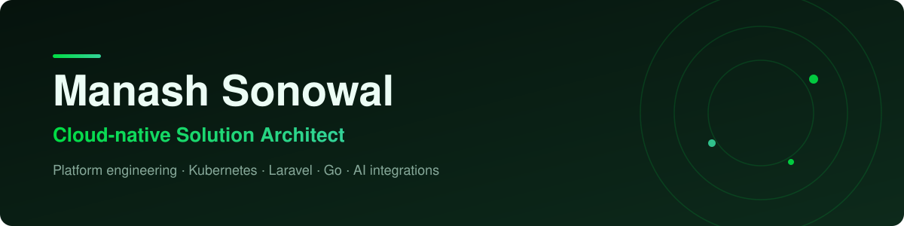

**Cloud-native solution architect, platform engineer & full-stack developer** · Hyderabad, India 🇮🇳
Founder of [**Clarity Technologies**](https://www.claritytech.io/). I design, build and rescue production systems: backends that stay fast under load, cloud infrastructure you can rebuild from code, and AI features that ship.

## 🛠 What I can help with

| | |
|---|---|
| **Solution architecture** | System design for mission-critical platforms: architecture reviews, scalability and reliability, disaster recovery, cloud cost and migration planning, build-vs-buy decisions, technical due diligence |
| **Cloud-native & Kubernetes** | Multi-cluster Kubernetes operations, GitOps delivery with Argo CD, CI/CD pipelines for Azure App Service apps, AWS ECS / GCP Cloud Run for simpler workloads, autoscaling, zero-downtime deploys |
| **Serverless** | AWS Lambda, API Gateway, SQS and EventBridge; PHP on Lambda with Bref, Node.js functions; event-driven and scheduled workloads, cold-start and cost tuning, deployed via Serverless Framework / SAM / Terraform |
| **Cloud & DevOps** | AWS (ECS, RDS, WAF, Athena, DR), GCP Cloud Run, Azure, Terraform, CloudFormation, Ansible, CI/CD with GitHub Actions and GitLab CI, Docker |
| **Laravel & PHP backends** | Laravel (Octane / FrankenPHP), APIs, queues, multi-tenant SaaS, billing, upgrades and performance tuning of legacy apps |
| **Real-time systems** | WebSocket and live-update architectures (Laravel Echo / Reverb, Node), scaling realtime connections, presence, notifications and live dashboards |
| **Node.js & TypeScript** | NestJS and Node APIs, webhook ingestion and queue workers, realtime servers, serverless functions, TypeScript tooling and monorepos |
| **Go (Golang)** | High-performance Go services and APIs, performance tuning, concurrent workers, CLIs, Wails desktop apps and developer tooling |
| **AI & observability** | LLM agents and RAG with evals and guardrails, MCP servers, NL-to-SQL, LLM cost control; monitoring, tracing and alerting with OpenTelemetry, Datadog and CloudWatch; SLOs and incident response |
| **Frontend** | Vue 3, Inertia, Nuxt, Astro, TypeScript, Tailwind, Livewire / Alpine |
| **Industries** | Healthcare (EHR / HL7, diagnostics, pharmacy), fintech and billing (invoicing, subscriptions, multi-currency), e-commerce, SaaS, travel, and ERP for small businesses. The patterns carry across domains |

## 🧰 Stack

**Backend** &nbsp;

**Frontend** &nbsp;

**Cloud & platform** &nbsp;

**CI/CD & GitOps** &nbsp;

## 🚀 Featured open source

| Project | What it is |
|---|---|
| [**InvoiceInk**](https://github.com/clarity-tech/invoiceInk) · [live demo](https://invoiceink.claritytech.io) | Open-source invoicing & estimates. Laravel, Inertia, Vue 3, TypeScript, multi-currency |
| [**docker-php-node**](https://github.com/msonowal/docker-php-node) · [Docker Hub](https://hub.docker.com/r/msonowal/docker-php-node) | PHP 8.2–8.5, Node 24 LTS and Composer on Alpine, with QA tools, for CI and local dev |
| [**tailwindcss-mcp-server**](https://github.com/clarity-contrib/tailwindcss-mcp-server) | MCP server giving AI assistants Tailwind v3/v4 docs and utilities |
| [**php-focal-backports**](https://github.com/clarity-tech/php-focal-backports) | Rebuilds patched PHP 8.1 for Ubuntu 20.04 / 26.04 (arm64 + amd64) |
| [**laravel-razor-pay-cashier**](https://github.com/msonowal/laravel-razor-pay-cashier) | Subscription billing boilerplate for Laravel on Razorpay |
| [**laravel-auditor**](https://github.com/msonowal/laravel-auditor) | Track and record model changes for Laravel, MongoDB-backed |
| [**laravel-money**](https://github.com/clarity-contrib/laravel-money) | Currency formatting and conversion for Laravel |

## 💼 Selected experience

- **Founder, Clarity Technologies**: product engineering and platform consulting for startups and enterprises across healthcare, fintech, e-commerce, travel and SaaS.
- **Stealth-stage startups** (under NDA): operating Kubernetes across multiple clusters, CI/CD for several apps on Azure App Service, and real-time WebSocket platforms.
- **Platform engineering at scale (healthcare)**: EHR and diagnostics services, notification-delivery pipelines, pharmacy and hospital web platforms, plus AWS disaster-recovery and IaC with Terraform.
- **Cloud cost & reliability**: database investigations, WAF/ALB log analysis, CI/CD standardisation across many services, runner and AMI automation.
- **AI products**: RAG-based website chat assistant (crawler, backend, embeddable widget), NL-to-SQL analytics, and self-hosted assistants on knowledge graphs.
- **Earlier**: Magento and Laravel e-commerce, Nuxt JAMStack sites, Shopify and payment integrations, Laravel packages used across projects.

## 📈 GitHub activity

## 🤝 Work with me

Architecture reviews · Kubernetes and CI/CD setup · Cloud migrations and cost cuts · Laravel builds and rescues · Real-time and AI integrations.

---

🎮 Off-hours: Warzone and racing sims (Dirt Rally, GRID, Forza Horizon).

